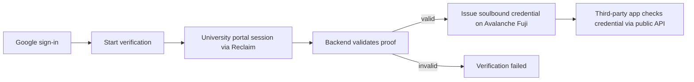

# StudentProof

Reusable on-chain proof of student status. Verify once with Google sign-in and a university-portal session; reuse the credential anywhere through a public verification API.

## Contents

- [Overview](#overview)
- [How it works](#how-it-works)
- [Key features](#key-features)
- [Architecture and tech stack](#architecture-and-tech-stack)
- [Student verification and issuance flow](#student-verification-and-issuance-flow)
- [Business and developer integration](#business-and-developer-integration)
- [Public verification API](#public-verification-api)
- [Project structure](#project-structure)
- [Prerequisites](#prerequisites)
- [Local development setup](#local-development-setup)
- [Environment variables](#environment-variables)
- [Database and Prisma](#database-and-prisma)
- [Smart contracts](#smart-contracts)
- [Available scripts](#available-scripts)
- [Testing and validation](#testing-and-validation)
- [Implementation status](#implementation-status)
- [Known limitations](#known-limitations)
- [Security and privacy](#security-and-privacy)
- [Roadmap](#roadmap)

## Overview

Many students cannot access discounts, tools, or services because verification depends on a university-issued (`.edu`) email address that their institution never provided. StudentProof replaces email-based checks with a reusable credential:

1. A student signs in with Google.
2. The student completes a verification session against their real university portal through Reclaim Protocol.
3. The backend validates the resulting proof.
4. A verified student is issued a non-transferable on-chain credential (soulbound token).
5. Third-party applications check that credential through a public API — no repeated ID uploads, no shared passwords.

Verification (proving student status) and issuance (minting the on-chain credential) are separate steps with separate statuses. A validated proof does not by itself mean a credential was issued; issuance is confirmed only after the mint transaction is reconciled on-chain.

## How it works



## Key features

- Google OAuth sign-in (Auth.js v5) for students and businesses.
- Reclaim Protocol verification against an authenticated university portal session (currently the SAMARTH provider).
- Server-side proof validation before anything is recorded as verified.
- Soulbound ERC-721 credentials on Avalanche Fuji with expiry and owner revocation.
- Recoverable issuance: atomic cross-instance claims, chain reconciliation before rebroadcast, bounded retries, and an authenticated retry endpoint.
- Dashboard showing each stage separately: proof pending/failed, issuance pending/failed, credential issued/expired/revoked.
- Business self-serve: Google sign-in issues an API key for the public verification endpoint.
- Public read-only verification API (`GET /api/verify`) returning a boolean — no student data.

## Architecture and tech stack

| Layer | Technology |
|---|---|
| App | Next.js 16 (App Router), React 19, TypeScript, Tailwind CSS, Framer Motion |
| Auth | Auth.js v5 (NextAuth beta), Google OAuth |
| Backend | Next.js Route Handlers (Node runtime) |
| Database | PostgreSQL (Aiven in production), Prisma ORM v7 with `@prisma/adapter-pg` |
| Verification | Reclaim Protocol (`@reclaimprotocol/js-sdk` v5) |
| Chain | Avalanche Fuji testnet (C-Chain, chain id 43113), `viem` |
| Contracts | Foundry (Solidity, OpenZeppelin): soulbound credential registry + provider registry |
| Email | Resend (welcome and API-key emails) |

There is no Stellar/Soroban code in this repository. The chain is Avalanche Fuji EVM.

## Student verification and issuance flow

1. **Sign in** — `POST` through Auth.js Google provider; a deterministic wallet address is derived for the student (`lib/wallet.ts`, `lib/auth-wallet.ts`).
2. **Start** — `POST /api/verification/start` creates a pending `VerificationRecord` and a Reclaim proof request bound to the SAMARTH provider id.
3. **Prove** — the student completes the university-portal session in the Reclaim flow.
4. **Validate** — `POST /api/verification/callback` (webhook) or `GET /api/verification/status` (polling fallback) runs `verifyProof` against the expected provider id. Invalid proofs are marked `failed`; nothing is minted.
5. **Issue** — on valid proof the record is marked `verified` and the issuance orchestrator (`lib/issuance-orchestrator.ts`, `lib/issuance-policy.ts`) attempts the mint: atomic claim, receipt/event reconciliation, bounded retries (5 attempts, exponential backoff). Failures keep the proof valid and the issuance recoverable via `POST /api/verification/retry`.
6. **View** — `/dashboard` renders proof status and issuance status independently, with retry actions only when the backend reports retry as safe.

## Business and developer integration

1. Open `/sdk` and choose Get API Access (Google sign-in with the business provider).
2. On first sign-in an API key is shown once and emailed; only its SHA-256 hash is stored (`Business` model, `lib/business-db.ts`).
3. Call the public endpoint with the key in the `x-api-key` header (server-side only — never in browser code).
4. Each successful call is logged as an `ApiUsageEvent` (with per-key attribution for dashboard-created keys).
5. Manage keys anytime on `/sdk` once signed in: create, list (creation date, status, usage), and revoke (`BusinessApiKey` model, session-authenticated `GET/POST /api/developer/keys` + `POST /api/developer/keys/[keyId]/revoke`). Revoked keys return `401` immediately; legacy sign-up keys keep working.

There is no installable SDK package. "SDK" in this repo means the documented HTTP API plus the curl/fetch examples on `/sdk`.

### SDK v1 — Sign in / Sign up with StudentProof (OAuth-style code flow)

Third-party apps verify students without handling wallets or emails — and without
their own Google OAuth client: StudentProof owns Google sign-in end to end.

- **Sign in:** app links to `GET /sdk/connect?client_id=…&redirect_uri=…&state=…&mode=signin` (plus PKCE `code_challenge`). The connect page offers two cards — **Continue with verified email** (existing account: Google sign-in, or one click when a session already exists) and **Verify my student status** (new students: continue to StudentProof verification first). The student consents on a screen stating **only a boolean student status is shared**, approves, and the app receives a one-time `code` at its registered `redirect_uri`. The app exchanges it server-to-server with its client secret plus the PKCE verifier, and gets back a 5-minute signed assertion: student status boolean bound to its own client id. No wallet, email, proof, or key ever appears in URLs.
- **Identity, precisely:** Google sign-in *identifies* the student; only the live credential check *determines* student status. Server-side identity anchors on the Google `sub` claim (`User.googleSub`, unique) → deterministic wallet → credential lookup. The email shown on the connect card is display-only profile text (`emailVerified` flag included for honesty); there is no by-email account lookup, so duplicate or unverified emails across Google accounts can never collide or impersonate, and nothing is ever auto-linked by matching email strings. Google sign-in alone proves nothing — an account without a live credential verifies as `false`, and outages fail closed instead of reporting `false`.
- **Sign up:** same entry with `mode=signup`; new students complete the standard Google + Reclaim flow on StudentProof (existing dashboard, no duplicate issuance — minting still goes exclusively through `markVerified`), then return through consent to the app.
- **Manual client registration (v1, no self-serve UI):** run these read-only-safe steps against the database with explicit approval, then hand the pair to the developer **once** (raw secret shown/emailed once, hash stored):
  1. Generate `clientId` as `sp_client_` + 16–64 `[A-Za-z0-9_-]` chars, and a 256-bit client secret; store only `SHA-256(secret)`.
  2. Record the app's exact `redirect_uri` values (production: `https` only; `http://localhost:*` only for local development) in `redirectUris`.
  3. Insert one `SdkClient` row (`clientId` unique; never reuse an id).
- **Assertion signing:** Ed25519 over `v2.<kid>.<payload>` with domain separation, pairwise `sub` per (client, user) so clients cannot correlate students. Relying parties verify with the **public** JWKS at `GET /api/sdk/jwks` — verification capability never implies minting capability (the pre-release v1 HMAC design, where every verifier held the shared secret, is retired). Rotation = publish a new public key under a new `kid`, sign with the new private key, keep the old public key for one overlap window, then drop it. Pairwise subjects derive from a dedicated `SDK_PAIRWISE_SECRET`, so signing-key rotation does not re-key relying-party user mappings. No database change is needed to rotate.
- Authorization codes: 256-bit, single-use, 10-minute expiry, SHA-256 hash storage, atomic redemption; PKCE S256 required. See `lib/sdk-crypto.ts`, `lib/sdk-keys.ts`, `lib/sdk-validation.ts`, `lib/sdk-codes.ts` and `lib/sdk-v1.selfcheck.ts`. Generate a keypair with `node scripts/generate-sdk-assertion-key.mjs` (secret shown once, never committed).

### SDK v1 token exchange (M3)

- `POST /api/sdk/token` with `grant_type=authorization_code`, `code`, `redirect_uri`, `client_id`, `client_secret`, `code_verifier` (form-encoded or JSON). Validation order is deliberate: body shape → per-client Valkey rate limit → client lookup → client-secret check (constant-time, same `invalid_client` response for unknown client and wrong secret) → code lookup → client/redirect binding → expiry/used pre-check → PKCE S256 verify → fresh on-chain credential re-evaluation → **atomic** single-use consume. A failing check never consumes a legitimate code.
- Success returns `200 { "assertion": "v2.…", "expires_in": 300 }` with `Cache-Control: no-store`. The assertion wire format is `v2.<kid>.<payload>.<sig>`; the payload carries only `{ v, iss, sub, aud, vb, iat, exp }` — version, issuer, pairwise subject, client audience, boolean status, timestamps. No email, wallet, Google ID, PRN, or university data.
- Failure codes (all JSON, no sensitive detail): `invalid_request` (400), `invalid_client` (401, unknown client or wrong secret — indistinguishable by design), `invalid_grant` (400: unknown/expired/used code, binding or PKCE mismatch, lost redemption race), `temporarily_unavailable` (502: chain read failed, code not consumed), `server_error` (500: signing misconfigured), plus shared `429`/`503` limiter responses.
- Integrators verify assertions with the public JWKS (`GET /api/sdk/jwks`, briefly cacheable): select the key by `kid` (refresh once on miss, covering rotation overlap), verify the Ed25519 signature over the domain-separated payload, then check `iss`, `aud` (their client id), boolean `vb`, and `exp`/`iat` with ±60s skew. Only a fully-verified assertion with `vb: true` gates access.
- Consent POSTs (`POST /api/sdk/authorize`) are protected by the SameSite session cookie (cross-site posts arrive unauthenticated and are rejected) plus an Origin check on present `Origin` headers, full server-side revalidation, and an explicit-denial path that is the only third-party redirect. Threat analysis: no session-bound nonce exists (would require new server storage); residual login-CSRF-by-malicious-client risk is contained by manual client vetting plus the consent screen naming the client.

### SDK v1 authorization endpoints (M2)

- `GET /sdk/connect?client_id=…&redirect_uri=…&state=…&mode=signin|signup&code_challenge=…&code_challenge_method=S256` — validates client, exact redirect match, and parameters; renders the two-card page (verified-email continue + verify-status), reusing an existing student session where present (Google sign-in preserves the flow parameters through `callbackUrl`). Unregistered clients/redirects render a local error card — never a redirect.
- `GET /sdk/authorize` (same params) — requires a student session (business accounts rejected); checks the authoritative on-chain credential; renders the consent screen or a local `verification_required` card. Nothing is shared before explicit Allow.
- `POST /api/sdk/authorize` with `decision=allow|deny` plus the same params — re-validates everything server-side, rate-limits per client (Valkey, fail-closed 429/503), then: `deny` → `302` to the exact registered URI with `?error=access_denied&state=…`; `allow` + valid credential → `302` with `?code=…&state=…`. Unverified students bounce back to our own `/sdk/authorize?error=verification_required` (never to the app, no code issued). Malformed calls get JSON `400`/`401`/`403` with fixed safe codes; chain outages get `502`. Raw codes travel once; only hashes persist.
- A standalone zero-dependency demo relying party exercises the whole login (`/` → authorize URL with state+PKCE → callback → server-side exchange → JWKS verify → session → logout). Live at https://demo-sdk-sp.vercel.app, source at https://github.com/dhanushonchain/demo-sdk-sp.

## Public verification API

This API answers one question: does a supplied wallet address hold an active
credential? It does **not** provide walletless student login — the calling app
supplies the wallet address (from its own checkout, form, or connected wallet).

```
GET /api/verify?wallet=0x...        Header: x-api-key: <your key>
```

- `200 { "valid": true | false }` — `true` only if the wallet holds at least one credential that is neither expired nor revoked (live `hasValidCredential` contract read; nothing cached).
- `401 { "error": ... }` — missing, unknown, or revoked API key.
- `400 { "error": ... }` — missing or malformed `wallet` parameter (zero address included).
- `429 { "error": ... }` — rate limit exceeded, with a `Retry-After` header (seconds).
- `502 / 503 { "error": ... }` — chain read failed / limiter unavailable. Unverifiable: fail closed (deny the gated action or retry later), never treat as either outcome.

Example:

```bash
curl "https://studentproof.app/api/verify?wallet=0xYourStudentWalletAddress" \
  -H "x-api-key: your_api_key_here"
```

```js
const res = await fetch(
  "https://studentproof.app/api/verify?wallet=0xYourStudentWalletAddress",
  {
    headers: { "x-api-key": process.env.STUDENTPROOF_API_KEY }, // server-side only
    signal: AbortSignal.timeout(10_000),
  }
);
if (!res.ok) throw new Error("unverifiable — fail closed, do not grant access");
const { valid } = await res.json();
```

```python
import os
import requests

resp = requests.get(
    "https://studentproof.app/api/verify",
    params={"wallet": "0xYourStudentWalletAddress"},
    headers={"x-api-key": os.environ["STUDENTPROOF_API_KEY"]},  # server-side only
    timeout=10,
)
resp.raise_for_status()  # non-200 means unverifiable: fail closed
valid: bool = resp.json()["valid"]
```

Calls are rate-limited to 60 requests per minute per developer account (sliding window shared across instances via Valkey). Exceeding the limit returns `429` with a `Retry-After` header; if the limiter is unavailable the API fails closed with `503`. Only a boolean is returned; no student data is exposed.

Keys are managed self-serve on `/sdk` (Google sign-in): the first key is shown once and emailed (only its hash is stored); further keys can be created, listed (creation date, status, per-key and account-level usage), and revoked at any time — revoked keys return `401` immediately. Secrets cannot be recovered; revoke and recreate if lost. Never bundle a real API key in browser-side code.

## Project structure

```
app/
  api/
    auth/[...nextauth]/     Auth.js handlers
    activity/logout/        Logout event logging
    verification/
      start/                Create record + Reclaim request  (POST)
      callback/             Proof webhook validation         (POST)
      status/               Polling validation + status      (GET)
      retry/                Authenticated issuance retry     (POST)
    verify/                 Public credential check          (GET)
    developer/keys/         Developer key management (session-authenticated GET/POST, revoke POST)
  dashboard/                Student dashboard (server page + client)
  docs/ pricing/ sdk/ login/  Marketing, docs, API-key signup (+ DeveloperKeysPanel)
  business/                 (empty placeholder)
components/                 nav-bar, hero, profile-menu, ui
contracts/
  src/                      StudentCredentialRegistry.sol, VerificationProviderRegistry.sol
  script/                   Deploy.s.sol, RedeployCredential.s.sol
  test/                     Foundry tests
  broadcast/                Fuji deployment artifacts (chain 43113)
packages/
  studentproof-oauth/       The public SDK, published as @studentproof/sdk: authorize-URL/PKCE builders (browser-safe src/index.ts) + server-side exchange and JWKS assertion verification (src/server.ts) + node:test suite
lib/
  issuance-orchestrator.ts  Claim/reconcile/mint/finalize + retry entry
  issuance-policy.ts        Lifecycle states, error categories, backoff
  verification-db.ts        Prisma store, DTOs, markVerified/markFailed
  verification-ui.ts        Pure dashboard state derivation
  credential-contract.ts    viem mint + receipt/event reads
  reclaim.ts                Provider id + proof-field extraction notes
  wallet.ts / auth-wallet.ts  Deterministic wallet derivation
  business-db.ts / business-email.ts / resend.ts / welcome-email.ts
  developer-keys.ts / developer-keys-policy.ts   Dashboard key CRUD (hash-only) + pure label/prefix checks
  *.selfcheck.ts            Dependency-free assert-based checks (see Testing)
prisma/
  schema.prisma             User, VerificationRecord, Credential, Business, BusinessApiKey, ApiUsageEvent, ActivityEvent
  migrations/               Ordered SQL migrations (incl. issuance lifecycle)
auth.ts / auth.config.ts    NextAuth instance + edge-safe config
middleware.ts               Protects /dashboard/*
```

## Prerequisites

- Node.js and npm (`package-lock.json` is the lockfile).
- A PostgreSQL database (Aiven in production; any Postgres works locally) with a `DATABASE_URL`. The app connects over standard PostgreSQL TCP via the `pg` driver — no vendor-specific adapter. For Aiven hosts the driver pins the project's public CA (`lib/certs/aiven-ca.pem`, full verification); other hosts keep default driver TLS behavior.
- Google OAuth credentials (client id + secret) with the redirect URI `<your-origin>/api/auth/callback/google` authorized.
- A Reclaim app id + secret with access to the configured provider.
- Avalanche Fuji RPC access (defaults to the public testnet endpoint) plus the deployed registry address; a funded minter key is required for real minting.
- A Resend API key for welcome/API-key emails (emails fail gracefully if misconfigured).
- Foundry (`forge`) for contract work.

## Local development setup

```bash
git clone <your-fork-url>
cd studentproof
npm install
cp .env.example .env.local   # there is no committed example file yet — create it from the table below
```

Then fill in `.env.local` (placeholders only — never commit real values), generate the client, and run:

```bash
./node_modules/.bin/prisma generate
npm run dev
```

Open `http://localhost:3000`. Sign in with Google using your own OAuth test client.

> Do not run `prisma migrate reset` or any destructive command against a shared database. Applying migrations to production requires explicit approval.

## Environment variables

Derived from `process.env` references in source (values never shown). Auth.js v5 also reads `AUTH_SECRET` itself.

| Variable | Purpose | Required | Used by |
|---|---|---|---|
| `AUTH_GOOGLE_ID` | Google OAuth client id | Yes | Auth.js providers |
| `AUTH_GOOGLE_SECRET` | Google OAuth client secret | Yes | Auth.js providers |
| `AUTH_SECRET` | Auth.js session encryption (read by the library) | Yes | Auth.js |
| `DATABASE_URL` | PostgreSQL connection string | Yes | Prisma |
| `RECLAIM_APP_ID` | Reclaim app id | Yes | Verification start/status |
| `RECLAIM_APP_SECRET` | Reclaim app secret | Yes | Verification start/status |
| `STUDENT_CREDENTIAL_REGISTRY_ADDRESS` | Deployed credential contract on Fuji | Yes for minting/verify | `credential-contract.ts` |
| `MINTER_PRIVATE_KEY` | Backend minter key for `mintCredential` | Yes for minting | `credential-contract.ts` |
| `AVALANCHE_WALLET_SECRET` | Server secret for wallet derivation | Yes | `wallet.ts` |
| `RESEND_API_KEY` | Resend key for emails | Yes for emails | `resend.ts` |
| `AVALANCHE_RPC_URL` | Fuji RPC endpoint (defaults to public testnet URL) | No | `credential-contract.ts` |
| `PUBLIC_URL` | Public base URL for the Reclaim webhook; unset = polling fallback | No | Verification start |
| `NODE_ENV` | Standard Node environment flag | No | Framework |
| `VALKEY_URL` | Valkey/Redis-compatible connection URL (`rediss://…` with TLS) for API rate limiting | Yes in production/preview | `verify-ratelimit.ts` |
| `VERIFY_RATELIMIT_BYPASS` | Set to `1` to disable rate limiting — local development only, never on Vercel | No (dev-only) | `verify-ratelimit.ts` |
| `SDK_ASSERTION_ED25519_PRIVATE_KEY` | PKCS#8 PEM of the current Ed25519 assertion-signing key (server-only; `\n` escapes allowed) | Yes for SDK token issuance | SDK v1 (`lib/sdk-keys.ts`) |
| `SDK_ASSERTION_ED25519_KID` | Key id of the current signing key (must equal its RFC 7638 thumbprint) | Yes for SDK token issuance | SDK v1 (`lib/sdk-keys.ts`) |
| `SDK_ASSERTION_ED25519_PREV_PUBLIC_JWK` | Previous public JWK (JSON), accepted during rotation overlap only | No | SDK v1 (`lib/sdk-keys.ts`, JWKS) |
| `SDK_PAIRWISE_SECRET` | HMAC secret deriving pairwise `sub` values (separate from signing keys) | Yes for SDK token issuance | SDK v1 (`lib/sdk-keys.ts`) |
| `SDK_ASSERTION_ISSUER` | `iss` claim + trust anchor (default `https://studentproof.app`) | No | SDK v1 (`lib/sdk-keys.ts`) |
| `STUDENTPROOF_STUB_CREDENTIALS` | `valid`/`invalid`/`error`: stub chain reads in isolated tests only. Ignored in production/preview runtimes | No (test-only) | `credential-contract.ts` |

The following appear only in Foundry scripts/docs, not in app runtime: `PRIVATE_KEY`, `MINTER_ADDRESS` (deploy scripts). No longer referenced anywhere in current source: distributor/Reclaim-private-key style legacy entries — do not add them to new setups.

## Database and Prisma

```bash
./node_modules/.bin/prisma generate        # regenerate the client (also runs on postinstall/build)
./node_modules/.bin/prisma validate        # validate schema.prisma
./node_modules/.bin/prisma migrate status  # read-only: compare history vs database
```

The issuance-lifecycle migration (`20261010000000_add_issuance_lifecycle`) is additive (new nullable/defaulted columns, one unique index) and was verified by applying the full history to a throwaway local Postgres. It is not yet applied to the shared database.

Timezone rule for any database this app touches: Prisma's PostgreSQL adapter reads and writes `timestamptz` columns as UTC-wall values, so the database session timezone must be UTC (as on the production hosts) — otherwise every instant-valued column skews by the session offset in both directions. Verified empirically: a throwaway cluster on an IST machine skewed ±5:30 until `ALTER DATABASE … SET timezone TO 'UTC'`, after which the full OAuth integration matrix passed. Never compensate in application code; keep hosts and sessions on UTC.

## Smart contracts

Deployed on Avalanche Fuji (chain id 43113; see `contracts/broadcast/`):

| Contract | Address (Fuji) |
|---|---|
| `VerificationProviderRegistry` | `0x5b123aef5cffa5a61443e43F080dd7C0A8C68fbF` |
| `StudentCredentialRegistry` (current) | `0x9869F9C3d2fC19c51ca73f8aC57d36f4861D20Ca` |
| `StudentCredentialRegistry` (superseded, abandoned) | `0xdfB22e778F5e1030eC44D8AddF409e05cbffBE19` |

Enforced on-chain behavior (see `contracts/src/`):

- `mintCredential` is `onlyMinter` and requires a trusted `providerId` — anyone else reverts.
- Soulbound: the `_update` override blocks transfers; `approve`/`setApprovalForAll` revert; minting still works.
- Each credential stores `providerId`, `issuedAt` (block time), `expiresAt` (caller-supplied), and a `revoked` flag; no personal data.
- `revokeCredential` is owner-only (soft revoke; the token remains on-chain).
- `hasValidCredential(wallet)` is true only with at least one non-revoked, non-expired token.

Contract commands (require Foundry):

```bash
forge build          # compile (run inside contracts/)
forge test           # 31 tests across both suites
```

Deployment scripts (`contracts/script/`) need `PRIVATE_KEY` and `MINTER_ADDRESS`; do not deploy without approval.

## Available scripts

```bash
npm run dev          # start the Next.js dev server
npm run build        # prisma generate + production build
npm start            # start the production server
npm run lint         # eslint over the repo
```

## Testing and validation

| What | Command | Status |
|---|---|---|
| Type check | `./node_modules/.bin/tsc --noEmit` | Clean |
| Lint (app scope) | `./node_modules/.bin/eslint app lib auth.ts auth.config.ts middleware.ts types` | 1 pre-existing error + 3 pre-existing warnings in untouched files |
| Production build | `npm run build` | Passes (all routes incl. `/api/sdk/jwks`, `/api/developer/keys`) |
| Foundry tests | `forge test` (in `contracts/`) | 31/31 pass |
| Issuance policy checks | compile + run `lib/issuance-policy.selfcheck.ts` | Pass |
| Issuance integration checks (mocked store/chain) | compile + run `lib/issuance-integration.selfcheck.ts` | 16/16 pass |
| Dashboard-state checks | compile + run `lib/verification-ui.selfcheck.ts` | Pass |
| Provider-shape checks | compile + run `lib/reclaim.selfcheck.ts` (dummy env, `server-only` stub) | Pass |
| Developer-key policy checks | compile + run `lib/developer-keys-policy.selfcheck.ts` | Pass |
| `@studentproof/sdk` kit tests (mocked fetch, live Ed25519 vectors, no network) | `node --test packages/studentproof-oauth/src/index.test.ts` | 9/9 pass |
| SDK v1 crypto/flow checks (Ed25519 v2, PKCE, bindings, fake-store concurrency) | compile + run `lib/sdk-v1.selfcheck.ts` | Pass |
| OAuth integration matrix (34 HTTP assertions vs isolated server + throwaway PG/Redis, stubbed chain) | throwaway driver (see Phase 2 report) | 34/34 pass |
| OAuth outage/revocation paths (502s without consuming codes; `vb:false` truthfulness; unverified bounce) | throwaway probes vs isolated server | Pass |
| Demo relying-party E2E (authorize URL → synthetic-session consent → callback → exchange → JWKS verify → session → logout) | throwaway demo + isolated server | Pass |

The `*.selfcheck.ts` files are dependency-free assert scripts (the repo has no app unit-test framework). Each header documents its exact compile-and-run command using the repo's own `tsc`. Mocks are used for Reclaim, RPC, and chain reads — no selfcheck touches a real service. Route-level OAuth evidence comes from the isolated matrix above (real Next server, real Postgres/Redis, stubbed chain reads, synthetic sessions standing in for Google login — the Google button click itself is the one flow that still needs dedicated OAuth credentials to test live).

## Implementation status

- Implemented in code: Google sign-in (student + business), wallet derivation, Reclaim start/callback/status polling, server-side proof validation, issuance lifecycle with claim/reconcile/retry, authenticated retry endpoint, dashboard states, business API keys, public `/api/verify`, emails.
- Covered by automated tests: contracts (31 forge tests), issuance policy/integration/UI derivation, provider-shape extraction, expiry math.
- Verified against scratch infrastructure: full migration history applies cleanly to throwaway Postgres.
- **Not verified end-to-end with live Google login:** the Google button click still needs dedicated OAuth test credentials (untested by design — no production accounts touched). Everything downstream of the session (consent, codes, exchange, assertions, demo login) is verified against the isolated matrix above using server-minted sessions through the real session path. Likewise still live-untested: a real Reclaim proof against the current provider, a real Fuji mint, and an external production integration. Do not treat isolated-test success as production readiness.

## Known limitations

- Cross-instance duplicate protection rests on the atomic DB claim plus the unique credential-per-record constraint; absolute on-chain exactly-once is impossible without a contract change (the contract intentionally allows multiple credentials per wallet), and re-verification may mint a second credential by design.
- No rate limiting on the retry endpoint; legacy single-column business keys cannot be individually revoked (create a dashboard key and stop using the legacy one instead).
- Webhook delivery requires `PUBLIC_URL`; without it the app relies on dashboard polling.
- `app/business/` is an empty placeholder; `/terms` and `/privacy` routes do not exist (footer marks them "soon").
- Full-repo `npm run lint` reports ~1100 errors inside vendored `contracts/lib` OpenZeppelin test files (lint scope misconfiguration, not app debt).
- The exact fields returned by the current Reclaim provider are unverified — issuance no longer depends on them by design.
- The new issuance migration must be applied to the shared database (with approval) before deploying this code; running this code against an unmigrated database will fail on the new columns.

## Security and privacy

- Never commit `.env*`, private keys, or API secrets; `.env` files in this repo are gitignored and contain no committed values.
- `server-only` modules (`credential-contract`, `reclaim`, wallet code) are dynamically imported so secrets never enter the Edge/client bundle.
- API keys are stored as SHA-256 hashes and shown once; retry/proof endpoints require the wallet session; foreign-record access returns 404 to prevent id probing.
- Only error *categories* are persisted or shown; raw RPC output, URLs, keys, stack traces, and raw Reclaim proofs never reach the UI, logs-as-feature, or the database. Console server logs may include operational errors — treat log aggregation as sensitive.
- Student wallets derive from a single server secret: a leak compromises all derived wallets. Use a secret manager and plan KMS/HSM custody before anything of value touches these wallets.
- The minter key can mint for any address by design (the contract cannot check off-chain proofs) — guard it, monitor for unexpected mints, and document a rotation runbook.
- Testnet only: credentials, addresses, and balances above are Avalanche Fuji. Proof validation is real cryptography; "reusable verification" discloses only the boolean credential status to relying apps — do not claim broader zero-knowledge guarantees.

## Roadmap

1. Live E2E rehearsal (login → real proof → Fuji mint → dashboard → `/api/verify`) with read-only contract checks first.
2. Apply the issuance migration to the shared database (approved `prisma migrate deploy`).
3. Key rotation/revocation, retry rate limits, multi-instance claim observation.
4. Real SDK client library vs documented HTTP API (decision + guides).
5. `/terms`, `/privacy`, `app/business` resolution; `.env.example`; CI; lint-scope fix; `LICENSE` file (none exists today — the old MIT badge was inaccurate).
6. Monitoring for mints, expiry notifications, multi-credential UI.
