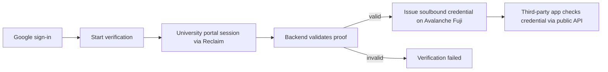

# StudentProof

Reusable on-chain proof of student status. Verify once with Google sign-in and a university-portal session; reuse the credential anywhere through a public verification API.

## Contents

- [Overview](#overview)
- [How it works](#how-it-works)
- [Key features](#key-features)
- [Architecture and tech stack](#architecture-and-tech-stack)
- [Student verification and issuance flow](#student-verification-and-issuance-flow)
- [Business and developer integration](#business-and-developer-integration)
- [Public verification API](#public-verification-api)
- [Project structure](#project-structure)
- [Prerequisites](#prerequisites)
- [Local development setup](#local-development-setup)
- [Environment variables](#environment-variables)
- [Database and Prisma](#database-and-prisma)
- [Smart contracts](#smart-contracts)
- [Available scripts](#available-scripts)
- [Testing and validation](#testing-and-validation)
- [Implementation status](#implementation-status)
- [Known limitations](#known-limitations)
- [Security and privacy](#security-and-privacy)
- [Roadmap](#roadmap)

## Overview

Many students cannot access discounts, tools, or services because verification depends on a university-issued (`.edu`) email address that their institution never provided. StudentProof replaces email-based checks with a reusable credential:

1. A student signs in with Google.
2. The student completes a verification session against their real university portal through Reclaim Protocol.
3. The backend validates the resulting proof.
4. A verified student is issued a non-transferable on-chain credential (soulbound token).
5. Third-party applications check that credential through a public API — no repeated ID uploads, no shared passwords.

Verification (proving student status) and issuance (minting the on-chain credential) are separate steps with separate statuses. A validated proof does not by itself mean a credential was issued; issuance is confirmed only after the mint transaction is reconciled on-chain.

## How it works



## Key features

- Google OAuth sign-in (Auth.js v5) for students and businesses.
- Reclaim Protocol verification against an authenticated university portal session (currently the SAMARTH provider).
- Server-side proof validation before anything is recorded as verified.
- Soulbound ERC-721 credentials on Avalanche Fuji with expiry and owner revocation.
- Recoverable issuance: atomic cross-instance claims, chain reconciliation before rebroadcast, bounded retries, and an authenticated retry endpoint.
- Dashboard showing each stage separately: proof pending/failed, issuance pending/failed, credential issued/expired/revoked.
- Business self-serve: Google sign-in issues an API key for the public verification endpoint.
- Public read-only verification API (`GET /api/verify`) returning a boolean — no student data.

## Architecture and tech stack

| Layer | Technology |
|---|---|
| App | Next.js 16 (App Router), React 19, TypeScript, Tailwind CSS, Framer Motion |
| Auth | Auth.js v5 (NextAuth beta), Google OAuth |
| Backend | Next.js Route Handlers (Node runtime) |
| Database | PostgreSQL via Neon, Prisma ORM v7 |
| Verification | Reclaim Protocol (`@reclaimprotocol/js-sdk` v5) |
| Chain | Avalanche Fuji testnet (C-Chain, chain id 43113), `viem` |
| Contracts | Foundry (Solidity, OpenZeppelin): soulbound credential registry + provider registry |
| Email | Resend (welcome and API-key emails) |

There is no Stellar/Soroban code in this repository. The chain is Avalanche Fuji EVM.

## Student verification and issuance flow

1. **Sign in** — `POST` through Auth.js Google provider; a deterministic wallet address is derived for the student (`lib/wallet.ts`, `lib/auth-wallet.ts`).
2. **Start** — `POST /api/verification/start` creates a pending `VerificationRecord` and a Reclaim proof request bound to the SAMARTH provider id.
3. **Prove** — the student completes the university-portal session in the Reclaim flow.
4. **Validate** — `POST /api/verification/callback` (webhook) or `GET /api/verification/status` (polling fallback) runs `verifyProof` against the expected provider id. Invalid proofs are marked `failed`; nothing is minted.
5. **Issue** — on valid proof the record is marked `verified` and the issuance orchestrator (`lib/issuance-orchestrator.ts`, `lib/issuance-policy.ts`) attempts the mint: atomic claim, receipt/event reconciliation, bounded retries (5 attempts, exponential backoff). Failures keep the proof valid and the issuance recoverable via `POST /api/verification/retry`.
6. **View** — `/dashboard` renders proof status and issuance status independently, with retry actions only when the backend reports retry as safe.

## Business and developer integration

1. Open `/sdk` and choose Get API Access (Google sign-in with the business provider).
2. On first sign-in an API key is shown once and emailed; only its SHA-256 hash is stored (`Business` model, `lib/business-db.ts`).
3. Call the public endpoint with the key in the `x-api-key` header.
4. Each successful call is logged as an `ApiUsageEvent`.

There is no installable SDK package. "SDK" in this repo means the documented HTTP API plus the curl/fetch examples on `/sdk`.

## Public verification API

```
GET /api/verify?wallet=0x...        Header: x-api-key: <your key>
```

- `200 { "valid": true | false }` — `true` only if the wallet holds at least one credential that is neither expired nor revoked (live `hasValidCredential` contract read; nothing cached).
- `401 { "error": ... }` — missing or invalid API key.
- `400 { "error": ... }` — missing or malformed `wallet` parameter.

Example:

```bash
curl "https://studentproof.app/api/verify?wallet=0xYourStudentWalletAddress" \
  -H "x-api-key: your_api_key_here"
```

```js
const res = await fetch(
  "https://studentproof.app/api/verify?wallet=0xYourStudentWalletAddress",
  { headers: { "x-api-key": "your_api_key_here" } }
);
const { valid } = await res.json();
```

No rate limiting is implemented yet. Only a boolean is returned; no student data is exposed.

## Project structure

```
app/
  api/
    auth/[...nextauth]/     Auth.js handlers
    activity/logout/        Logout event logging
    verification/
      start/                Create record + Reclaim request  (POST)
      callback/             Proof webhook validation         (POST)
      status/               Polling validation + status      (GET)
      retry/                Authenticated issuance retry     (POST)
    verify/                 Public credential check          (GET)
  dashboard/                Student dashboard (server page + client)
  docs/ pricing/ sdk/ login/  Marketing, docs, API-key signup
  business/                 (empty placeholder)
components/                 nav-bar, hero, profile-menu, ui
contracts/
  src/                      StudentCredentialRegistry.sol, VerificationProviderRegistry.sol
  script/                   Deploy.s.sol, RedeployCredential.s.sol
  test/                     Foundry tests
  broadcast/                Fuji deployment artifacts (chain 43113)
lib/
  issuance-orchestrator.ts  Claim/reconcile/mint/finalize + retry entry
  issuance-policy.ts        Lifecycle states, error categories, backoff
  verification-db.ts        Prisma store, DTOs, markVerified/markFailed
  verification-ui.ts        Pure dashboard state derivation
  credential-contract.ts    viem mint + receipt/event reads
  reclaim.ts                Provider id + proof-field extraction notes
  wallet.ts / auth-wallet.ts  Deterministic wallet derivation
  business-db.ts / business-email.ts / resend.ts / welcome-email.ts
  *.selfcheck.ts            Dependency-free assert-based checks (see Testing)
prisma/
  schema.prisma             User, VerificationRecord, Credential, Business, ApiUsageEvent, ActivityEvent
  migrations/               Ordered SQL migrations (incl. issuance lifecycle)
auth.ts / auth.config.ts    NextAuth instance + edge-safe config
middleware.ts               Protects /dashboard/*
```

## Prerequisites

- Node.js and npm (`package-lock.json` is the lockfile).
- A PostgreSQL database (the project uses Neon in production; any Postgres works locally) with a `DATABASE_URL`.
- Google OAuth credentials (client id + secret) with the redirect URI `<your-origin>/api/auth/callback/google` authorized.
- A Reclaim app id + secret with access to the configured provider.
- Avalanche Fuji RPC access (defaults to the public testnet endpoint) plus the deployed registry address; a funded minter key is required for real minting.
- A Resend API key for welcome/API-key emails (emails fail gracefully if misconfigured).
- Foundry (`forge`) for contract work.

## Local development setup

```bash
git clone <your-fork-url>
cd studentproof
npm install
cp .env.example .env.local   # there is no committed example file yet — create it from the table below
```

Then fill in `.env.local` (placeholders only — never commit real values), generate the client, and run:

```bash
./node_modules/.bin/prisma generate
npm run dev
```

Open `http://localhost:3000`. Sign in with Google using your own OAuth test client.

> Do not run `prisma migrate reset` or any destructive command against a shared database. Applying migrations to Neon/production requires explicit approval.

## Environment variables

Derived from `process.env` references in source (values never shown). Auth.js v5 also reads `AUTH_SECRET` itself.

| Variable | Purpose | Required | Used by |
|---|---|---|---|
| `AUTH_GOOGLE_ID` | Google OAuth client id | Yes | Auth.js providers |
| `AUTH_GOOGLE_SECRET` | Google OAuth client secret | Yes | Auth.js providers |
| `AUTH_SECRET` | Auth.js session encryption (read by the library) | Yes | Auth.js |
| `DATABASE_URL` | PostgreSQL connection string | Yes | Prisma |
| `RECLAIM_APP_ID` | Reclaim app id | Yes | Verification start/status |
| `RECLAIM_APP_SECRET` | Reclaim app secret | Yes | Verification start/status |
| `STUDENT_CREDENTIAL_REGISTRY_ADDRESS` | Deployed credential contract on Fuji | Yes for minting/verify | `credential-contract.ts` |
| `MINTER_PRIVATE_KEY` | Backend minter key for `mintCredential` | Yes for minting | `credential-contract.ts` |
| `AVALANCHE_WALLET_SECRET` | Server secret for wallet derivation | Yes | `wallet.ts` |
| `RESEND_API_KEY` | Resend key for emails | Yes for emails | `resend.ts` |
| `AVALANCHE_RPC_URL` | Fuji RPC endpoint (defaults to public testnet URL) | No | `credential-contract.ts` |
| `PUBLIC_URL` | Public base URL for the Reclaim webhook; unset = polling fallback | No | Verification start |
| `NODE_ENV` | Standard Node environment flag | No | Framework |

The following appear only in Foundry scripts/docs, not in app runtime: `PRIVATE_KEY`, `MINTER_ADDRESS` (deploy scripts). No longer referenced anywhere in current source: distributor/Reclaim-private-key style legacy entries — do not add them to new setups.

## Database and Prisma

```bash
./node_modules/.bin/prisma generate        # regenerate the client (also runs on postinstall/build)
./node_modules/.bin/prisma validate        # validate schema.prisma
./node_modules/.bin/prisma migrate status  # read-only: compare history vs database
```

The issuance-lifecycle migration (`20261010000000_add_issuance_lifecycle`) is additive (new nullable/defaulted columns, one unique index) and was verified by applying the full history to a throwaway local Postgres. It is not yet applied to the shared database.

## Smart contracts

Deployed on Avalanche Fuji (chain id 43113; see `contracts/broadcast/`):

| Contract | Address (Fuji) |
|---|---|
| `VerificationProviderRegistry` | `0x5b123aef5cffa5a61443e43F080dd7C0A8C68fbF` |
| `StudentCredentialRegistry` (current) | `0x9869f9c3d2fc19c51ca73f8aC57d36f4861D20Ca` |
| `StudentCredentialRegistry` (superseded, abandoned) | `0xdfB22e778F5e1030eC44D8AddF409e05cbffBE19` |

Enforced on-chain behavior (see `contracts/src/`):

- `mintCredential` is `onlyMinter` and requires a trusted `providerId` — anyone else reverts.
- Soulbound: the `_update` override blocks transfers; `approve`/`setApprovalForAll` revert; minting still works.
- Each credential stores `providerId`, `issuedAt` (block time), `expiresAt` (caller-supplied), and a `revoked` flag; no personal data.
- `revokeCredential` is owner-only (soft revoke; the token remains on-chain).
- `hasValidCredential(wallet)` is true only with at least one non-revoked, non-expired token.

Contract commands (require Foundry):

```bash
forge build          # compile (run inside contracts/)
forge test           # 31 tests across both suites
```

Deployment scripts (`contracts/script/`) need `PRIVATE_KEY` and `MINTER_ADDRESS`; do not deploy without approval.

## Available scripts

```bash
npm run dev          # start the Next.js dev server
npm run build        # prisma generate + production build
npm start            # start the production server
npm run lint         # eslint over the repo
```

## Testing and validation

| What | Command | Status |
|---|---|---|
| Type check | `./node_modules/.bin/tsc --noEmit` | Clean |
| Lint (app scope) | `./node_modules/.bin/eslint app lib auth.ts auth.config.ts middleware.ts types` | 1 pre-existing error + 3 pre-existing warnings in untouched files |
| Production build | `npm run build` | Passes (14 routes incl. `/api/verification/retry`) |
| Foundry tests | `forge test` (in `contracts/`) | 31/31 pass |
| Issuance policy checks | compile + run `lib/issuance-policy.selfcheck.ts` | Pass |
| Issuance integration checks (mocked store/chain) | compile + run `lib/issuance-integration.selfcheck.ts` | 16/16 pass |
| Dashboard-state checks | compile + run `lib/verification-ui.selfcheck.ts` | Pass |
| Provider-shape checks | compile + run `lib/reclaim.selfcheck.ts` (dummy env, `server-only` stub) | Pass |

The `*.selfcheck.ts` files are dependency-free assert scripts (the repo has no app unit-test framework). Each header documents its exact compile-and-run command using the repo's own `tsc`. Mocks are used for Reclaim, RPC, and chain reads — no selfcheck touches a real service.

## Implementation status

- Implemented in code: Google sign-in (student + business), wallet derivation, Reclaim start/callback/status polling, server-side proof validation, issuance lifecycle with claim/reconcile/retry, authenticated retry endpoint, dashboard states, business API keys, public `/api/verify`, emails.
- Covered by automated tests: contracts (31 forge tests), issuance policy/integration/UI derivation, provider-shape extraction, expiry math.
- Verified against scratch infrastructure: full migration history applies cleanly to throwaway Postgres; Neon shows the new migration as pending (not applied).
- **Not verified end-to-end:** live Google login, a real Reclaim proof against the current provider, a real Fuji mint, and an external developer integration. Do not treat mocked-test success as production readiness.

## Known limitations

- Cross-instance duplicate protection rests on the atomic DB claim plus the unique credential-per-record constraint; absolute on-chain exactly-once is impossible without a contract change (the contract intentionally allows multiple credentials per wallet), and re-verification may mint a second credential by design.
- No rate limiting on public or retry endpoints; no API-key rotation/revocation yet.
- Webhook delivery requires `PUBLIC_URL`; without it the app relies on dashboard polling.
- `app/business/` is an empty placeholder; `/terms` and `/privacy` routes do not exist (footer marks them "soon").
- Full-repo `npm run lint` reports ~1100 errors inside vendored `contracts/lib` OpenZeppelin test files (lint scope misconfiguration, not app debt).
- The exact fields returned by the current Reclaim provider are unverified — issuance no longer depends on them by design.
- The new issuance migration must be applied to the shared database (with approval) before deploying this code; running this code against an unmigrated database will fail on the new columns.

## Security and privacy

- Never commit `.env*`, private keys, or API secrets; `.env` files in this repo are gitignored and contain no committed values.
- `server-only` modules (`credential-contract`, `reclaim`, wallet code) are dynamically imported so secrets never enter the Edge/client bundle.
- API keys are stored as SHA-256 hashes and shown once; retry/proof endpoints require the wallet session; foreign-record access returns 404 to prevent id probing.
- Only error *categories* are persisted or shown; raw RPC output, URLs, keys, stack traces, and raw Reclaim proofs never reach the UI, logs-as-feature, or the database. Console server logs may include operational errors — treat log aggregation as sensitive.
- Student wallets derive from a single server secret: a leak compromises all derived wallets. Use a secret manager and plan KMS/HSM custody before anything of value touches these wallets.
- The minter key can mint for any address by design (the contract cannot check off-chain proofs) — guard it, monitor for unexpected mints, and document a rotation runbook.
- Testnet only: credentials, addresses, and balances above are Avalanche Fuji. Proof validation is real cryptography; "reusable verification" discloses only the boolean credential status to relying apps — do not claim broader zero-knowledge guarantees.

## Roadmap

1. Live E2E rehearsal (login → real proof → Fuji mint → dashboard → `/api/verify`) with read-only contract checks first.
2. Apply the issuance migration to the shared database (approved `prisma migrate deploy`).
3. Key rotation/revocation, retry rate limits, multi-instance claim observation.
4. Real SDK client library vs documented HTTP API (decision + guides).
5. `/terms`, `/privacy`, `app/business` resolution; `.env.example`; CI; lint-scope fix; `LICENSE` file (none exists today — the old MIT badge was inaccurate).
6. Monitoring for mints, expiry notifications, multi-credential UI.
